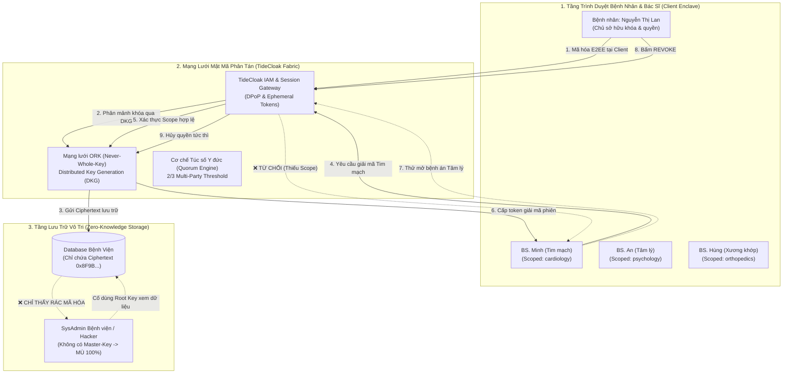
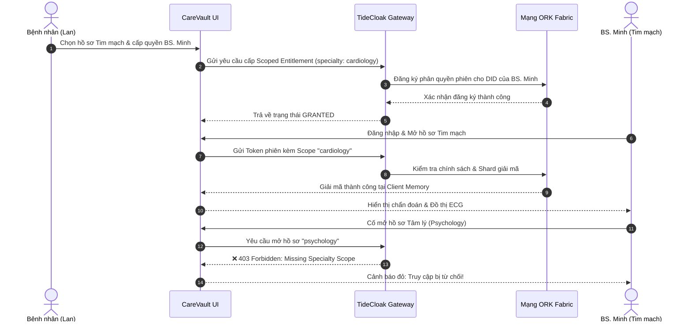
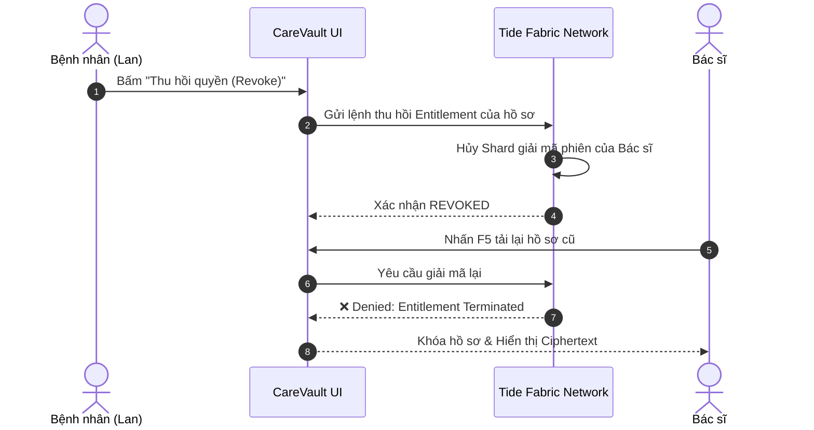

# 🏛️ KIẾN TRÚC HỆ THỐNG CAREVAULT (CAREVAULT SYSTEM ARCHITECTURE)
## TÀI LIỆU THIẾT KẾ KIẾN TRÚC & MẬT MÃ PHÂN TÁN (DISTRIBUTED CRYPTOGRAPHIC ARCHITECTURE WHITEPAPER)

> **Dự án:** CareVault – Patient-Sovereign Health Vault  
> **Nền tảng bảo mật:** [TideCloak](https://tide.org/tidecloak) (Tide Foundation)  
> **Tiêu chuẩn áp dụng:** Emergent Authority, Ineffable Cryptography, Hermetic E2EE, Quorum Governance

---

## 1. TỔNG QUAN KIẾN TRÚC (HIGH-LEVEL ARCHITECTURE)

Khác với các hệ thống y tế điện tử (EHR/EMR) truyền thống vốn đặt niềm tin vào máy chủ trung tâm và người quản trị cơ sở dữ liệu (*Centralized Custody*), CareVault áp dụng mô hình **Thẩm quyền Phân tán (Emergent Authority)**. Dữ liệu bệnh án không có chủ sở hữu tối thượng là bệnh viện hay công ty phần mềm, mà quyền lực thuộc về chính người bệnh.

---

## 2. BỐN TẦNG KIẾN TRÚC CỐT LÕI (THE 4 ARCHITECTURAL TIERS)

### Tầng 1: Client Enclave & User Experience Layer
* **Công nghệ:** React 19, `@tidecloak/react`, Vite, Tailwind CSS.
* **Đặc tính kỹ thuật:**
  * Dữ liệu y tế giả lập (`seed.json`) được xử lý và phân tách ngay tại máy khách.
  * Không bao giờ lưu trữ dữ liệu văn bản thô (Plaintext) vào `localStorage` hay `sessionStorage`.
  * Bộ chuyển đổi vai trò (*Role Switcher*) tương tác trực tiếp với Context của TideCloak để mô phỏng các vai trò thực tế.

### Tầng 2: TideCloak Decentralized Fabric Layer
* **Công nghệ:** TideCloak Authentication Server, Orchestrated Recluders of Keys (ORK), DPoP (Demonstration of Proof-of-Possession).
* **Đặc tính kỹ thuật:**
  * **Never-Whole-Key Model:** Không một máy chủ đơn lẻ nào nắm giữ trọn vẹn khóa giải mã. Khóa được phân mảnh theo cơ chế *Nested Shamir Secret Sharing* trên mạng lưới các node ORK.
  * **Session-bound Decryption:** Khóa giải mã chỉ được phát hành tạm thời cho phiên làm việc của bác sĩ đáp ứng đủ 2 điều kiện: (1) Được bệnh nhân gắn thẻ ủy quyền chuyên khoa, và (2) Trạng thái hồ sơ chưa bị thu hồi (`status === "granted"`).

### Tầng 3: Medical Quorum Governance Layer
* **Công nghệ:** Multi-Party Threshold Signature Policy.
* **Đặc tính kỹ thuật:**
  * Áp dụng cho các thao tác y tế nhạy cảm: sửa đổi đơn thuốc, cập nhật chẩn đoán pháp y hoặc điều chỉnh hồ sơ sau phẫu thuật.
  * Một bác sĩ hay giám đốc bệnh viện đơn phương bấm sửa sẽ bị hệ thống kích hoạt ngoại lệ `[UNILATERAL_OVERRIDE_PREVENTED]`.
  * Yêu cầu tối thiểu **2/3 chữ ký độc lập** (ví dụ: Bác sĩ điều trị + Chủ tịch Hội đồng Y đức) mới có thể hợp thức hóa dữ liệu.

### Tầng 4: Zero-Knowledge Persistence Layer
* **Công nghệ:** PostgreSQL / MySQL / Object Storage.
* **Đặc tính kỹ thuật:**
  * Cơ sở dữ liệu của bệnh viện đóng vai trò là một **"Kho chứa vô tri" (Blind Custodian)**.
  * Dữ liệu được lưu trữ dưới dạng Ciphertext nhị phân. Dù máy chủ bị chiếm quyền Root hoặc cơ sở dữ liệu bị rò rỉ 100%, dữ liệu thu được vẫn chỉ là các chuỗi toán học không thể dịch ngược.

---

## 3. SƠ ĐỒ TUẦN TỰ MẬT MÃ (CRYPTOGRAPHIC SEQUENCE FLOWS)

### 3.1. Luồng Tiết lộ có chọn lọc (Selective Scoped Disclosure)

### 3.2. Luồng Thu hồi quyền tức thì (Instant Revocation)

---

## 4. MA TRẬN MÔ HÌNH THỰC THỂ & PHÂN QUYỀN (RBAC & ENTITY MODEL)

| Thực thể (Entity) | Vai trò (Role) | Thẩm quyền dữ liệu (Data Authority) | Cơ chế kiểm soát |
| :--- | :--- | :--- | :--- |
| **Bệnh nhân (Lan)** | `ROLE_PATIENT` | Toàn quyền sở hữu: Đọc, Mã hóa, Cấp quyền, Thu hồi quyền | Tự chủ hoàn toàn (Patient Sovereignty) |
| **BS. Minh** | `ROLE_DOCTOR_CARDIO` | Đọc hồ sơ Tim mạch khi còn hiệu lực | Scoped Entitlement (`cardiology`) |
| **BS. An** | `ROLE_DOCTOR_PSYCH` | Đọc bệnh án Tâm lý khi còn hiệu lực | Scoped Entitlement (`psychology`) |
| **BS. Hùng** | `ROLE_DOCTOR_ORTHO` | Đọc hồ sơ X-Quang khi còn hiệu lực | Scoped Entitlement (`orthopedics`) |
| **Hội đồng Y đức** | `ROLE_ETHICS_PANEL` | Phê duyệt sửa đổi bệnh án nhạy cảm | Quorum Threshold (≥ 2/3 chữ ký) |
| **SysAdmin Bệnh viện** | `ROLE_HOSPITAL_ADMIN` | Vận hành máy chủ, xem trạng thái hệ thống | **Zero-Knowledge** (Không có quyền giải mã) |

---

## 5. MÔ HÌNH ĐE DỌA & BIỆN PHÁP BẢO VỆ (THREAT MODEL & MITIGATIONS)

| Nguy cơ tấn công (Threat) | Kẻ tấn công (Attacker) | Hệ thống truyền thống | CareVault với TideCloak |
| :--- | :--- | :--- | :--- |
| **Rò rỉ toàn bộ Database (DB Dump)** | Hacker / Kỹ sư DBA nội bộ | Toàn bộ bệnh án bị lộ dưới dạng Plaintext | **Miễn nhiễm.** Chỉ lấy được Ciphertext; không có master key để giải mã. |
| **Xem chéo hồ sơ (Cross-Snooping)** | Bác sĩ chuyên khoa khác | Xem lén được bệnh án tâm thần, phá thai | **Bị chặn.** Fabric từ chối cấp khóa giải mã cho chuyên khoa không hợp lệ. |
| **Sử dụng quyền sau điều trị** | Bác sĩ đã bị chấm dứt đợt khám | Vẫn xem được dữ liệu cũ nếu lưu link | **Bị chặn.** Khi bệnh nhân bấm Revoke, lượt giải mã tiếp theo bị từ chối triệt để. |
| **Sửa đổi hồ sơ che giấu lỗi y khoa** | Bác sĩ / Giám đốc BV | Âm thầm cập nhật database che đậy | **Bị chặn.** Cơ chế Quorum yêu cầu 2/3 chữ ký từ Hội đồng Y đức độc lập. |

---

## 6. ĐỐI CHUẨN PHÁP LÝ Y TẾ (REGULATORY COMPLIANCE MAPPING)

Kiến trúc CareVault được thiết kế tương thích với các quy định y tế khắt khe nhất:
1. **HIPAA (Hoa Kỳ - 45 CFR § 164.312):** Đạt tiêu chuẩn về *Transmission Security* và nguyên tắc *Minimum Necessary Access* (Chỉ cấp quyền tối thiểu cần thiết để chữa bệnh).
2. **GDPR (Châu Âu - Article 9):** Bảo vệ danh mục dữ liệu sức khỏe đặc biệt nhạy cảm và hiện thực hóa *Quyền được rút lại sự đồng thuận (Right to Withdraw Consent)* chỉ bằng 1 nút bấm.
3. **Luật Khám bệnh, chữa bệnh Việt Nam 2023 (Điều 69):** Hiện thực hóa bằng công nghệ quyền của người bệnh được bảo mật thông tin khám chữa bệnh và đời tư.
